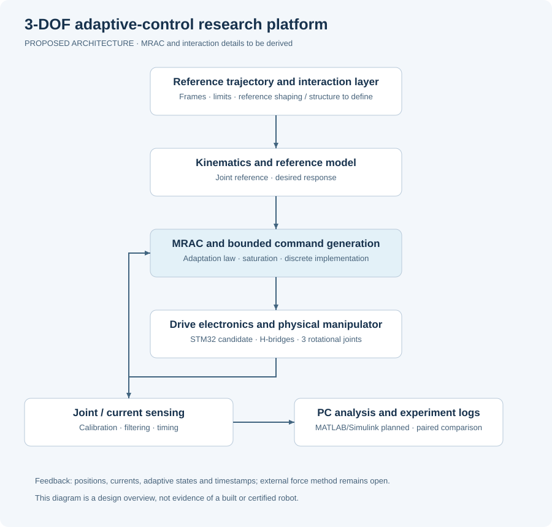

# Proposed real-time architecture

## Control path

The proposal outlines a reference trajectory, an interaction/reference-shaping layer, inverse kinematics, a reference model, an adaptive controller, current/torque commands, drive electronics, and the physical manipulator. Encoder and current feedback close the measurement path.

This is a high-level intent. The selected plant model, control input, motor-driver interface, current-loop availability, contact measurement, and layer interconnection must be made explicit before an executable controller is claimed.

## Timing and observability

Plan a hardware-timer-driven control tick. Separate acquisition/control execution from decimated telemetry and user-interface work. Measure actual sampling instant, loop period, execution time, jitter, missed deadlines, and worst observed load. A configured timer rate alone does not prove a 1 kHz controller.

Candidate telemetry fields are timestamp, cycle counter, q_ref, q_measured, estimated q_dot, motor currents, drive commands, saturation/limit flags, controller mode, payload event, and adaptive parameters. Units, sign conventions, firmware version, and calibration must accompany logs.

## Hardware boundary

The STM32H7-class board is a candidate, not a finalized pin map. Joint-side feedback and motor-side encoders measure different parts of the transmission. Drivers need to be selected with measured current requirements and the chosen command/current-control architecture in mind.

## Fault handling

Define startup, calibration/homing, idle, enabled motion, controlled stop, and fault states. Determine behavior for missing/stale encoder data, excess current, supply problems, limit activation, deadline overruns, and numerical errors. E-stop and protection verification must precede integrated motion tests.
